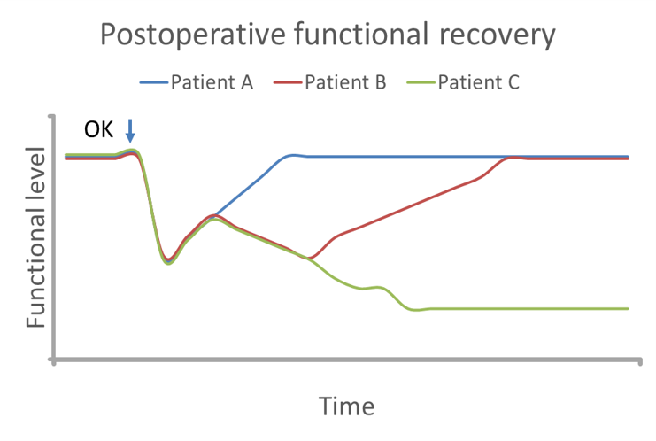

<a href="/research/02_perioperative/">Perioperative monitoring research</a>

Using perioperative measurements and electronic medical records to identify patients at risk of deterioration and support clinical decision making.

<nav aria-label="On this page" id="contents">
<strong>On this page</strong>
<ol class="research-line__contents-list">
<li><a href="#overview">Overview</a></li>
<li><a href="#predicting-unanticipated-icu-admission">Predicting unanticipated ICU admission</a></li>
<li><a href="#combining-different-forms-of-deterioration">Combining different forms of deterioration</a></li>
<li><a href="#external-validation-of-early-warning-models">External validation of early warning models</a></li>
<li><a href="#continuous-monitoring-on-the-surgical-ward">Continuous monitoring on the surgical ward</a></li>
<li><a href="#phd-theses">PhD theses</a></li>
<li><a href="#selected-publications-and-resources">Selected publications and resources</a></li>
<li><a href="#contributors-and-partners">Contributors and partners</a></li>
</ol></nav>

## Overview

In critical care medicine, timely identification and intervention in response to patient deterioration play a pivotal role in shaping clinical outcomes. Failure to rescue, defined as the inability to promptly recognize and address deteriorating patient states, poses a significant challenge.

Current approaches often use scoring systems that assign numerical values to a few vital signs, such as heart rate, respiratory rate, blood pressure, and body temperature. These methods rely on predetermined thresholds and may not perform equally well in all patient populations. Low specificity can contribute to alarm fatigue, while intermittent assessments may miss transient or rapid changes.

In this line of research, we investigate approaches to predict patient deterioration earlier and more accurately by exploiting the wealth of information available in hospitals.

## Predicting unanticipated ICU admission

In a first study, we investigated whether unanticipated admission to the intensive care unit (ICU) could be predicted using variables extracted from the electronic medical record at different phases of the perioperative period: before, during, and after surgery.

**Main finding:** Combining intra- and early postoperative factors with preoperative patient factors achieved an **AUC of 0.86 (95% CI 0.83–0.88)** for predicting unanticipated ICU admission.

This emphasizes the potential value of clinical decision support in postanesthesia care units when deciding on postoperative patient allocation.

[Read Mestrom et al., PLOS ONE, 2023](https://doi.org/10.1371/journal.pone.0286818).

<figure style="max-width: 650px; margin-left: auto; margin-right: auto;">

</figure>

## Combining different forms of deterioration

We subsequently investigated unanticipated ICU admission and in-hospital mortality both separately and as a combined outcome. The study compared the contribution of perioperative features and the performance of logistic regression with more complex machine learning classifiers.

**Main finding:** Combining ICU admission and mortality improved prediction of the combined outcome, but reduced accuracy for the individual outcomes. Interpretable logistic regression performed well compared with the more complex classifiers evaluated.

The low frequency of deterioration events remains an important limitation. The results motivate further validation and the evaluation of models that preserve information about different forms of deterioration.

[Read Bakkes et al., Perioperative Medicine, 2024](https://doi.org/10.1186/s13741-024-00420-9).

## External validation of early warning models

A prediction model developed in one hospital may perform differently in another. We evaluated the Advanced Alert Monitor (AAM) using electronic medical records from Catharina Hospital, comparing it with the National Early Warning Score (NEWS) and a locally optimized AAM.

**Main finding:** The locally optimized AAM outperformed the original AAM and NEWS under both outcome definitions evaluated. Changing the definition of deterioration also changed the relative performance of the original AAM and NEWS.

This work highlights the importance of local validation, model adaptation, and careful definition of the outcome a prediction system is intended to detect.

[Read Bakkes et al., International Journal of Medical Informatics, 2025](https://doi.org/10.1016/j.ijmedinf.2025.105930).

## Continuous monitoring on the surgical ward

Related work evaluates how wearable-derived early warning scores can complement routine nurse-measured observations. In a continuously monitored surgical ward, we studied the transition from mandatory to discretionary nurse-measured MEWS assessments and compared two wearable-derived scores with conventional MEWS.

The wearable-derived scores showed comparable but modest discrimination. The study also highlighted the need to evaluate alert burden and the integration of continuous measurements into clinical workflows.

[Read Jerry et al., Journal of Clinical Monitoring and Computing, 2026](https://doi.org/10.1007/s10877-026-01488-y).

## PhD theses

- **Tom Bakkes (2025):** [Machine learning for clinical decision support in perioperative and intensive care](https://pure.tue.nl/ws/portalfiles/portal/353886332/20250403_Bakkes_hf.pdf).
- **Eveline Mestrom (2023):** [Early warning systems in clinical care: towards new approaches to improve patient deterioration detection](https://pure.tue.nl/ws/portalfiles/portal/295633561/20230418_CO_Mestrom_hf.pdf).

## Selected publications and resources

1. Mestrom EHJ, Bakkes THGF, Ourahou N, Korsten HHM, de Andrade Serra P, Montenij LJ, Mischi M, Turco S, Bouwman RA. **Prediction of postoperative patient deterioration and unanticipated intensive care unit admission using perioperative factors.** PLOS ONE, 2023. [Read the paper](https://doi.org/10.1371/journal.pone.0286818).
2. Bakkes THGF, Mestrom EHJ, Ourahou N, …, Turco S. **Predictive modeling of perioperative patient deterioration: combining unanticipated ICU admissions and mortality for improved risk prediction.** Perioperative Medicine, 2024. [Read the paper](https://doi.org/10.1186/s13741-024-00420-9).
3. Bakkes THGF, De Bie Dekker AJR, van der Stam JA, …, Turco S. **Validation of the advanced alert monitor in a Dutch hospital using local optimization and refinement of the outcome definition.** International Journal of Medical Informatics, 2025. [Read the paper](https://doi.org/10.1016/j.ijmedinf.2025.105930).
4. Jerry EE, Afonso MA, De Vries JC, Akkermans A, Turco S, Bouwman AR, Nienhuijs SW. **Transition from mandatory to discretionary nurse-measured MEWS assessment in a continuously monitored surgical ward: diagnostic performance of wearable-derived early warning scores.** Journal of Clinical Monitoring and Computing, 2026. [Read the paper](https://doi.org/10.1007/s10877-026-01488-y).

## Contributors and partners

### Research team

* Tom Bakkes (former PhD student, now postdoctoral researcher)
* Eveline Mestrom (former PhD student)
* Uzay Kaymak (part-time professor)
* Arthur Bouwman (part-time professor)
* Massimo Mischi (full professor, head of BM/d)

### Collaborators and partners

* Catharina Ziekenhuis Eindhoven
* Philips Research

### Funding

* Eindhoven Medtech Innovation Center (e/MTIC)
* TKI-HTSM MEDICAID - Top Sector Holland High Tech

<figure style="max-width: 700px; margin-left: auto; margin-right: auto;">

</figure>

<a href="#contents">Back to contents</a> · <a href="/research/02_perioperative/">Perioperative monitoring research</a> · <a href="/publications/">Publications and code</a>

