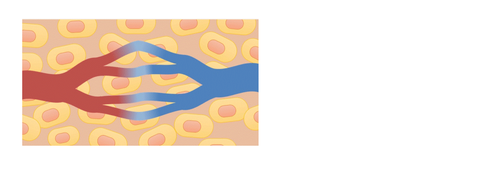
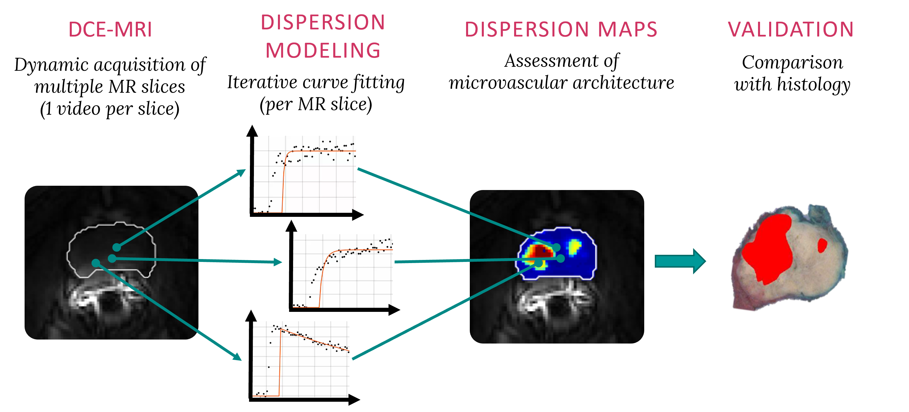
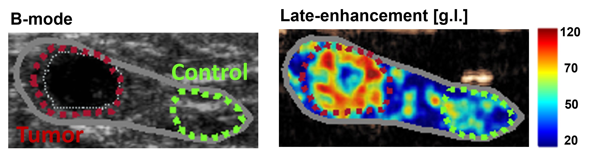
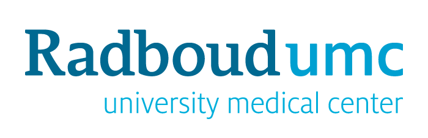
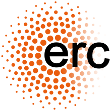

<a href="/research/01_cancer/">Cancer imaging research</a>

Quantitative assessment of cancer angiogenesis by modeling contrast transport, leakage, and molecular binding in dynamic MRI and ultrasound.

<nav aria-label="On this page" id="contents">
<strong>On this page</strong>
<ol class="research-line__contents-list">
<li><a href="#overview">Overview</a></li>
<li><a href="#magnetic-resonance-dispersion-imaging-mrdi">Magnetic resonance dispersion imaging</a></li>
<li><a href="#ultrasound-molecular-imaging">Ultrasound molecular imaging</a></li>
<li><a href="#publications-and-resources">Publications and resources</a></li>
<li><a href="#contributors-and-partners">Contributors and partners</a></li>
</ol></nav>

## Overview

Cancer represents a global health challenge. The recognition of angiogenesis, i.e., the formation of a vascular supply, as a key regulator of cancer growth, has opened new possibilities for both cancer diagnostics and therapy. Cancer vasculature, exhibiting peculiar structural, functional and molecular features different from normal vessels, is the target of novel anti-angiogenic therapies. Although angiogenesis imaging holds great potential for improved cancer detection and localization, therapy monitoring, and treatment follow-up, its clinical translation is hampered by the lack of standardization of methods and protocols, and by the limited accuracy and reliability of available techniques.

In this line of research, we propose quantitative assessment of cancer angiogenesis by combining dynamic contrast-enhanced imaging with pharmacokinetic modeling of the contrast agent kinetics. With the proposed approach, time-intensity curves obtained at each imaging pixel are fitted by a suitable model describing the contrast transport through the investigated organ. This enables the estimation of quantitative parameters, which are directly related to the structural, functional and molecular changes occurring in tumor vasculature due to cancer angiogenesis.

## Magnetic resonance dispersion imaging (MRDI)

Dispersion modeling is proposed to describe the transport kinetics of extravascular contrast agents, such as those typically used in magnetic resonance imaging. With this approach, the contrast concentration in the tissue is described as a convolution of the intravascular contrast concentration with the tissue impulse response. Intravascular transport is modeled as a Brownian motion process using the convective-dispersion equation, while the tissue impulse response is represented by a mono-exponential decay describing contrast leakage into the extravascular space. Dispersion features of the intravascular transport are adopted to assess the microvascular architecture, while the leakage rate is estimated to provide an assessment of the microvascular permeability. Both features are typically altered in cancer angiogenic vasculature.

<figure style="max-width: 650px; margin-left: auto; margin-right: auto;">

<figcaption>Animation schematically describing the transport of gadolinium-based MR contrast agents (left). The contrast agent flows through the intravascular space (IV) and at the capillary level extravasates into the extravascular extracellular space (EES). This can be described mathematically by a 2-compartment model (right). <a href="/images/pk_mri.gif" target="_blank" rel="noopener">View full-size figure</a></figcaption>
</figure>

In a <a href="https://journals.lww.com/investigativeradiology/abstract/2014/08000/magnetic_resonance_dispersion_imaging_for.8.aspx" target="_blank">proof-of-concept</a> of the proposed approach performed on 15 patients for prostate cancer localization, dispersion analysis provided the highest accuracy for cancer detection compared to state-of-the-art perfusion-related and permeability-related parameters.

Parameter estimation was optimized by providing analytical solutions of the dispersion model both in time and frequency domains. The <a href="https://www.sciencedirect.com/science/article/abs/pii/S1746809415001913?via%3Dihub" target="_blank">computational efficiency</a> was increased by about 50% without reduction in the estimation and diagnostic performance.

The validation of magnetic resonance dispersion imaging was consequently extended in a <a href="https://ajronline.org/doi/full/10.2214/AJR.17.19215" target="_blank">multicenter study</a> including 80 prostate-cancer patients.

**Main finding:** In the multicenter study, dispersion analysis provided an **AUC of 0.91** for prostate cancer localization, outperforming the other methods evaluated.

Moreover, the correlation of in-vivo imaging parameters with the ex-vivo histological assessment of tumor grade (aggressiveness) was investigated. A weak but significant correlation between the dispersion parameter and the Gleason grade was found.

<figure style="max-width: 650px; margin-left: auto; margin-right: auto;">

<figcaption>MRDI workflow: First, dynamic acquisitions of multiple MR slices (2D + time) are performed. Then the time-intensity curves are extracted at each voxel and fitted by the dispersion model by iterative least-squares curve fitting, enabling the extraction of parametric maps characterizing the vascular architecture and vascular permeability. The obtained parameters are then compared to the ground truth represented by the histological analysis of corresponding prostate slices. <a href="/images/MRDI_workflow.png" target="_blank" rel="noopener">View full-size figure</a></figcaption>
</figure>

## Ultrasound molecular imaging

A binding model was developed for molecular imaging of angiogenesis by novel targeted contrast agents. In dynamic contrast-enhanced ultrasound, these agents are composed of intravascular microbubbles, whose shell has been functionalized with targeting ligands able to bind specific molecules over-expressed on the vessel walls of angiogenic tumor vasculature. The kinetics of such agents is described as a bi-compartmental model, with one compartment describing the freely flowing microbubbles, modeled by the convective-dispersion equation, and one compartment accounting for the bound microbubbles, described as an accumulating compartment. The binding rate is thus estimated and adopted for molecular assessment of angiogenesis.

<figure style="max-width: 650px; margin-left: auto; margin-right: auto;">

<figcaption>Example of USMI acquisition and processing in a rat model of prostate cancer. The B-mode (left) shows the location of the tumor. The late-enhancement map (right) clearly shows higher values at the tumor location. <a href="/images/usmi.png" target="_blank" rel="noopener">View full-size figure</a></figcaption>
</figure>

The feasibility of the proposed approach for quantitative <a href="https://iopscience.iop.org/article/10.1088/1361-6560/aa5e9a/meta" target="_blank">molecular imaging</a> of angiogenesis was shown in prostate tumor-bearing rats injected with a clinical-grade molecularly-targeted ultrasound contrast agent. The binding rate was able to discriminate between malignant and benign tissue, with a shorter and simplified protocol compared to semi-quantitative assessment by available molecular imaging methods.

Subsequently, the validity of the proposed model was investigated by comparing the binding rate values in rats injected with a targeted and a non-targeted contrast agent. The estimated values were significantly smaller for non-targeted agents, with no difference between cancer and healthy tissue, confirming the validity of the proposed approach.

A <a href="https://link.springer.com/article/10.1007/s11307-018-1274-z" target="_blank">longitudinal study</a> was performed in colon-cancer-bearing mice undergoing anti-angiogenic treatment, to test the feasibility of the proposed method for monitoring the response to therapy.

**Main finding:** In this preclinical study, the binding rate decreased significantly after treatment and was able to discriminate between responders and non-responders.

## Publications and resources

This line of research is summarized in my <a href="https://pure.tue.nl/ws/files/88738712/20180117_Turco.pdf" target="_blank"> PhD thesis</a> and has been further advanced for contrast-enhanced ultrasound with <a href="/portfolio/06_Nanobubbles/" target="_blank"> nanobubble contrast agents</a>. An additional great resource is our book entitled <a href="https://link.springer.com/content/pdf/10.1007/978-3-319-64638-1.pdf" target="_blank">  "Quantification of contrast kinetics in clinical imaging"</a>.

1. Mischi M, Turco S, Lavini C, et al. **Magnetic resonance dispersion imaging for localization of angiogenesis and cancer growth.** Investigative Radiology, 2014. [Read the paper](https://doi.org/10.1097/RLI.0000000000000056).
2. Turco S, Janssen AJEM, Lavini C, et al. **Time-efficient estimation of the magnetic resonance dispersion model parameters for quantitative assessment of angiogenesis.** Biomedical Signal Processing and Control, 2016. [Read the paper](https://doi.org/10.1016/j.bspc.2015.11.006).
3. Turco S, Lavini C, Heijmink S. **Evaluation of magnetic-resonance dispersion imaging for improved prostate cancer diagnosis through a multicenter study.** American Journal of Roentgenology, 2018. [Read the paper](https://doi.org/10.2214/AJR.17.19215).
4. Turco S, Tardy I, Frinking P, Wijkstra H, Mischi M. **Quantitative ultrasound molecular imaging by modeling the binding kinetics of targeted contrast agent.** Physics in Medicine and Biology, 2017. [Read the paper](https://doi.org/10.1088/1361-6560/aa5e9a).
5. Turco S, El Kaffas A, Zhou J, et al. **Pharmacokinetic modeling of targeted ultrasound contrast agents for quantitative assessment of anti-angiogenic therapy: a longitudinal case-control study in colon cancer.** Molecular Imaging and Biology, 2019. [Read the paper](https://doi.org/10.1007/s11307-018-1274-z).

## Contributors and partners

### Research team

* Massimo Mischi (full professor, head of BM/d)
* Hessel Wijkstra (part-time professor)

### Collaborators and partners

* Amsterdam University Medical Center
* Stanford Medicine
* Bracco Imaging S.p.A.
* Radboud University Medical Center
* Netherlands Cancer Institute (Antoni van Leeuwenhoek)

### Funding

* ERC Starting Grant
* NWO STW

  <figure class="research-line__partner-logo">

</figure>
  <figure class="research-line__partner-logo">

</figure>
  <figure class="research-line__partner-logo">

</figure>
  <figure class="research-line__partner-logo">

</figure>
  <figure class="research-line__partner-logo">

</figure>
  <figure class="research-line__partner-logo">

</figure>
  <figure class="research-line__partner-logo">

</figure>

<a href="#contents">Back to contents</a> · <a href="/research/01_cancer/">Cancer imaging research</a> · <a href="/publications/">Publications and code</a>

