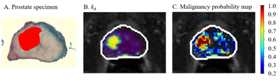
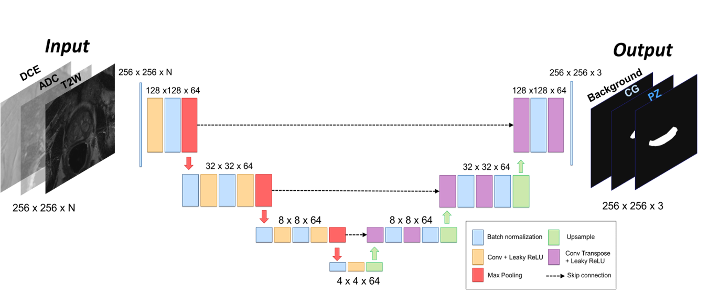
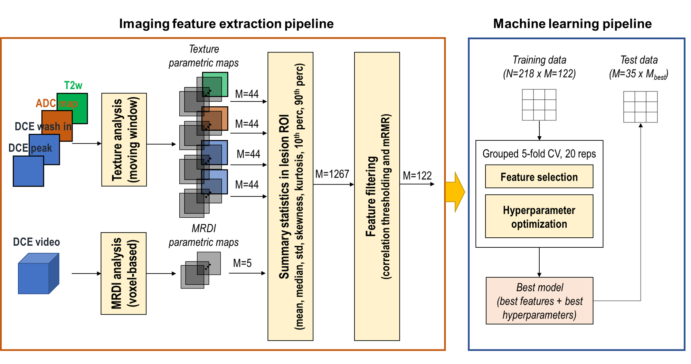
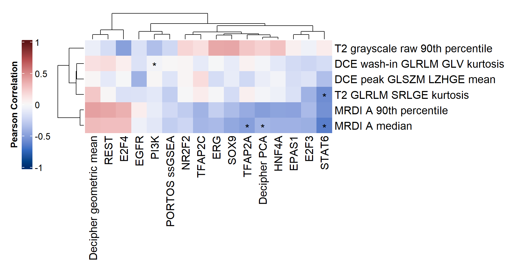
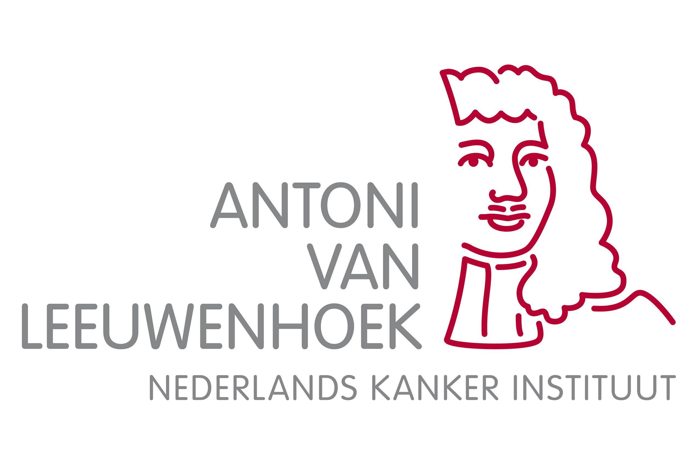
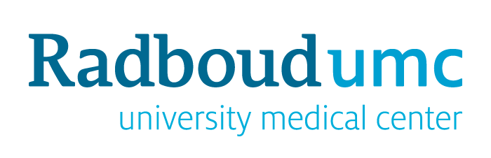
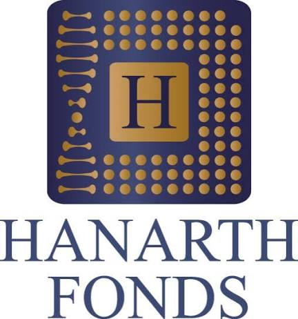

<a href="/research/01_cancer/">Cancer imaging research</a>

Extracting quantitative parameters from multiparametric MRI and combining them by machine learning for prostate cancer detection and characterization, while investigating their link with tumor biology.

<nav aria-label="On this page" id="contents">
<strong>On this page</strong>
<ol class="research-line__contents-list">
<li><a href="#overview">Overview</a></li>
<li><a href="#dce-mri-radiomics-for-prostate-cancer-detection">DCE-MRI radiomics</a></li>
<li><a href="#deep-learning-for-prostate-zonal-segmentation">Prostate zonal segmentation</a></li>
<li><a href="#radiogenomics-of-prostate-cancer">Radiogenomics</a></li>
<li><a href="#selected-publications-and-resources">Publications and resources</a></li>
<li><a href="#contributors-and-partners">Contributors and partners</a></li>
</ol></nav>

## Overview

Prostate cancer is a prevalent malignancy that continues to pose significant challenges in diagnosis, risk stratification, and treatment planning. Multiparametric magnetic resonance imaging (mpMRI) has emerged as a powerful tool for prostate cancer assessment, providing detailed anatomical and functional information. Radiomics extends beyond traditional image interpretation by extracting and analyzing a vast array of quantitative features from medical images.

## DCE-MRI radiomics for prostate cancer detection

Multiparametric MRI combines T2-weighted, diffusion-weighted, and dynamic contrast-enhanced (DCE) imaging. A purely qualitative analysis of the DCE-MRI time series, as it is generally done by radiologists, might overlook information on the microvascular architecture and function.

<figure style="max-width: 480px; margin-left: auto; margin-right: auto;">

<figcaption>A. Prostate specimen with histopathological tumor delineation (in red), B. kd dispersion map, and C. malignancy probability map for an example patient. <i>Taken from Fernandes, C.D. et al.  IEEE EMBC</i>. 2021. <a href="/images/dce-mri-radiomics.png" target="_blank" rel="noopener">View full-size figure</a></figcaption>
</figure>

Motivated by this, we investigated whether a <a href="https://pubmed.ncbi.nlm.nih.gov/34891910" target="_blank">radiomic combination of spatial and temporal features extracted from DCE-MRI</a> improved the detection of prostate cancer.

**Main finding:** A selected combination of quantitative spatial and temporal features extracted from DCE-MRI and incorporated in machine learning classifiers achieved an **AUC of 0.80–0.86** in distinguishing malignant from benign regions.

## Deep learning for prostate zonal segmentation

Prostate zonal segmentation is a pivotal step in the automation of prostate cancer (PCa) diagnosis, MRI-guided radiotherapy, and focal treatment planning. In this study, we introduce a <a href="https://archive.ismrm.org/2022/2832.html" target="_blank">multi-channel U-Net for automatic prostate zonal segmentation</a>, capable of accommodating multiple MRI sequences.

<figure style="max-width: 650px; margin-left: auto; margin-right: auto;">

<figcaption>Multi-channel U-Net for automatic prostate zonal segmentation. One or more channels are used to input one or more MRI sequences. <a href="/images/DL_zonal_arch.png" target="_blank" rel="noopener">View full-size figure</a></figcaption>
</figure>

Using a multicenter, multiparametric MRI dataset, we examine the model's robustness in the face of varied acquisition protocols and assess whether the inclusion of additional imaging sequences enhances segmentation performance.

**Main finding:** T2-weighted imaging alone was sufficient for successful prostate zonal segmentation in this study. Despite using a modest multicenter dataset, the models were robust across acquisition protocols, with performance comparable to that reported for larger datasets from a single institute.

These findings support the use of automated prostate zonal segmentation across different acquisition protocols.

## Radiogenomics of prostate cancer

Radiogenomics explores the relationship between imaging features and underlying genomic alterations within the tumor. Combining imaging and genomics offers insights into the molecular landscape that traditional imaging alone may not capture, with the aim of improving tumor characterization and risk stratification.

<figure style="max-width: 650px; margin-left: auto; margin-right: auto;">

<figcaption>Feature extraction and machine learning pipeline to select the most relevant features. <a href="/images/imaging_pipe.png" target="_blank" rel="noopener">View full-size figure</a></figcaption>
</figure>

Using a unique dataset of prostate cancer patients who underwent mpMRI and whose biopsied tumor tissue was sequenced, we explored <a href="https://www.mdpi.com/2072-6694/15/12/3074" target="_blank"> radiogenomics in prostate cancer</a>. We investigated whether imaging features extracted from multiparametric MRI correlated with transcriptomic features extracted from RNA sequencing. To this end, we developed machine learning frameworks to identify the most relevant imaging and transcriptomics features and analyzed the correlation between them.

<figure style="max-width: 650px; margin-left: auto; margin-right: auto;">

<figcaption>Heatmap describing the Pearson correlation between imaging and transcriptomics features. Only coefficients with <i>p</i>-value ≤0.2
 are shown. * <i>p</i> < 0.05. <a href="/images/NKI_correlations_0.1.png" target="_blank" rel="noopener">View full-size figure</a></figcaption>
</figure>

**Main finding:** We found significant correlations between perfusion-based imaging features extracted from MRDI and transcriptomic features related to cell proliferation and migration, and associated with prostate cancer aggressiveness and progression.

## Selected publications and resources

1. Dinis Fernandes C, Mischi M, Wijkstra H, Barentsz JO, Heijmink SWTPJ, Turco S. **Radiomic combination of spatial and temporal features extracted from DCE-MRI for prostate cancer detection.** IEEE EMBC, 2021. [Read the paper](https://doi.org/10.1109/EMBC46164.2021.9630015).
2. Turco S, Blach H, Dinis Fernandes C, et al. **Deep learning for prostate zonal segmentation robust to multicenter data.** ISMRM, 2022, abstract 2832. [Read the abstract](https://archive.ismrm.org/2022/2832.html).
3. Dinis Fernandes C, Schaap A, Kant J, …, Turco S. **Radiogenomics analysis linking multiparametric MRI and transcriptomics in prostate cancer.** Cancers, 2023. [Read the paper](https://doi.org/10.3390/cancers15123074).
4. Jager A, Oddens JR, Postema AW, …, Turco S. **Is there an added value of quantitative DCE-MRI by magnetic resonance dispersion imaging for prostate cancer diagnosis?** Cancers, 2024. [Read the paper](https://doi.org/10.3390/cancers16132431).

The modelling underlying MRDI is described on the [pharmacokinetic modelling research page](/portfolio/01_pk_modeling/). Related articles and conference papers are collected on my [publications and resources page](/publications/).

## Contributors and partners

### Research team

* Catarina Dinis Fernandes (assistant professor)
* Hubert Blach (former master student)
* Annekoos Schaap (former master student)

### Collaborators and partners

* Biomodelling group (ICMS, Biomedical Engineering), TU/e
* Amsterdam University Medical Center
* Netherlands Cancer Institute (Antoni van Leeuwenhoek)
* Radboud University Medical Center

### Funding

* Hanarth Fonds fellowship
* KNAW Van Leersum grant

  <figure class="research-line__partner-logo">

</figure>
  <figure class="research-line__partner-logo">

</figure>
  <figure class="research-line__partner-logo">

</figure>
  <figure class="research-line__partner-logo">

</figure>
  <figure class="research-line__partner-logo">

</figure>

<a href="#contents">Back to contents</a> · <a href="/research/01_cancer/">Cancer imaging research</a> · <a href="/publications/">Publications and code</a>

