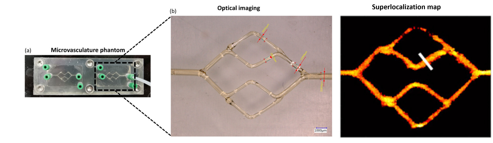
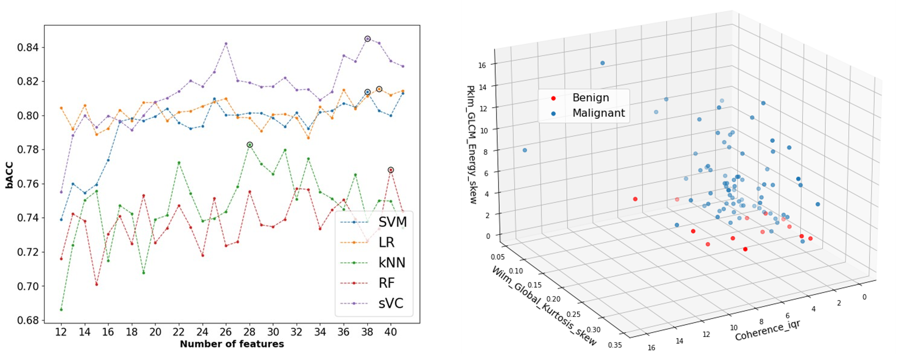
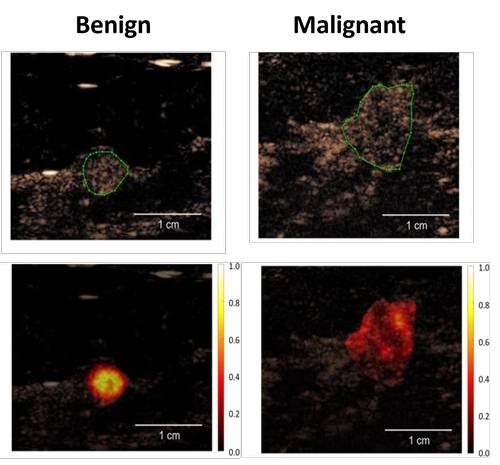

<a href="/research/01_cancer/">Cancer imaging research</a>

Quantitative analysis of contrast-enhanced ultrasound to characterize perfusion, microvascular architecture, and tissue heterogeneity.

<nav aria-label="On this page" id="contents">
<strong>On this page</strong>
<ol class="research-line__contents-list">
<li><a href="#overview">Overview</a></li>
<li><a href="#ceus-for-hemodynamic-quantification">CEUS for hemodynamic quantification</a></li>
<li><a href="#quantitative-ceus-for-classification-of-liver-lesions">Quantitative CEUS for classification of liver lesions</a></li>
<li><a href="#motion-compensation-in-liver-ceus">Motion compensation in liver CEUS</a></li>
<li><a href="#quantitative-ceus-for-breast-lesion-differentiation">Quantitative CEUS for breast lesion differentiation</a></li>
<li><a href="#cudi-for-renal-cell-carcinoma">CUDI for renal cell carcinoma</a></li>
<li><a href="#selected-publications-and-resources">Selected publications and resources</a></li>
<li><a href="#contributors-and-partners">Contributors and partners</a></li>
</ol></nav>

## Overview

With the use of ultrasound contrast agents (UCAs), such as microbubbles, CEUS enables enhanced visualization of blood flow and tissue perfusion. Beyond qualitative assessment, CEUS quantification aims to extract measurable information on vascular and tissue characteristics. Quantitative analysis in CEUS involves temporal, spatial, and spatiotemporal analyses of contrast agent kinetics. In this line of research, we develop quantitative analysis methods to extract multiple quantitative maps from CEUS, reflecting complementary variables of underlying physiological processes. Using probabilistic frameworks based on emerging machine-learning methods, we aim to enhance the diagnostic accuracy of CEUS imaging through the optimal combination of extracted complementary information.

A general introduction on this topic can be found in our review paper <a href="https://www.sciencedirect.com/science/article/pii/S030156291931590X?via%3Dihub" target="_blank"> "Contrast-Enhanced Ultrasound Quantification: From Kinetic Modeling to Machine Learning."</a>.

## CEUS for hemodynamic quantification

Over the past decades, significant advancements in hemodynamic quantification methods have evolved based on CEUS imaging. In particular, our group has developed contrast-ultrasound dispersion imaging (CUDI) techniques, allowing the quantification of cancer angiogenesis. These techniques involve temporal, spatial, and spatiotemporal analysis of CEUS acquisitions to extract parameters related to blood perfusion and contrast dispersion. Encouragingly, CUDI techniques have demonstrated promising results in localizing prostate cancer.

Despite these advancements, the clinical translation of many methods faces challenges such as the lack of validation under controllable conditions, limited understanding of the relationship between hemodynamics and tissue properties, and issues with imaging efficiency, reliability, and diagnostic accuracy. Therefore, the primary goal of this project was to facilitate the clinical translation and enhance the clinical value of a set of CEUS-based hemodynamic quantification techniques.

With this goal in mind, we initially designed and constructed controllable, realistic, and perfusable (micro)vascular phantom models. These models were utilized for conducting quantitative hemodynamics analysis and optimizing contrast-enhanced ultrasound (CEUS) imaging efficiency in vitro. Subsequently, we focused on the development and validation of hemodynamic quantification methods specifically tailored for implementation in existing clinical scanners. The emphasis is on enhancing their diagnostic accuracy in vivo.

This line of research is summarized in <a href="https://pure.tue.nl/ws/portalfiles/portal/297639802/20230602_Chen_P._hf.pdf" target="_blank">Peiran Chen’s PhD thesis</a>.

<figure style="max-width: 650px; margin-left: auto; margin-right: auto;">

<figcaption>Examples of dual-bifurcation phantom fabricated by sugar-printing, together with corresponding super-resolution imaging. Adapted from Peiran Chen's thesis. <a href="/images/peiran_superres.png" target="_blank" rel="noopener">View full-size figure</a></figcaption>
</figure>

## Quantitative CEUS for classification of liver lesions

Imaging plays a crucial role in the diagnosis, staging, and monitoring of liver cancer. In this work, we investigate quantitative methods for distinguishing benign and malignant focal liver lesions (FLLs).

Motivated by this, we proposed an <a href="https://ieeexplore.ieee.org/document/9740202" target="_blank">interpretable radiomics method</a> to distinguish between cancerous and non-cancerous focal liver lesions (FLLs) using contrast-enhanced ultrasound (CEUS). While CEUS holds promise for diagnosing FLLs, clinical interpretation often relies on qualitative analysis, often hindered by motion artifacts and the complex nature of liver contrast enhancement. To overcome these challenges, we propose combining temporal and spatiotemporal analysis of arterial phase enhancement by CUDI, with texture analysis at various time points. Machine learning classifiers are then trained using these features for semi-automated FLL characterization.

**Main finding:** In **87 focal liver lesions from 72 at-risk patients**, the radiomics approach achieved a **balanced accuracy of 0.84** for distinguishing benign and malignant lesions.

Feature analysis highlights the importance of combining spatiotemporal and texture features for optimal performance, particularly focusing on microvascular perfusion, architecture, and spatial enhancement characteristics.

<figure style="max-width: 650px; margin-left: auto; margin-right: auto;">

<figcaption>Plot of the balanced accuracy as a function of the number of selected features for five different classifiers (left). Scatter plot of the top three radiomics features for differentiation of FLLs, with red labels for benign lesions and blue labels for malignant cases (right). It can be noticed that three features provide already a good separation between the classes. <a href="/images/interpretable_ML.png" target="_blank" rel="noopener">View full-size figure</a></figcaption>
</figure>

## Motion compensation in liver CEUS

Ultrasound imaging of the liver is, however, unavoidably affected by motion. This limits the robustness of feature extraction and hinders the application of additional quantification techniques which are affected by motion. To overcome this challenge, we proposed a motion compensation algorithm, named the <a href="https://www.sciencedirect.com/science/article/abs/pii/S0301562922004409" target="_blank">Iterative Local Search Algorithm (ILSA)</a>. This algorithm effectively addresses both periodic and non-periodic in-plane motion while eliminating frames with out-of-plane motion in contrast-enhanced ultrasound (CEUS) cines. We tested the algorithm on 183 focal liver lesions in 155 patients from three hospitals. Quantitatively, we observed a significant decrease in median root mean square error and in B-mode intensity standard deviation, and a significant increase in R2. Qualitatively, B-Mode mean intensity projection images indicated improved spatial resolution, and parametric perfusion imaging demonstrated enhanced spatial detail and better differentiation between lesions and background liver parenchyma. ILSA proves effective in compensating for various motion types encountered during liver CEUS, potentially enhancing the quantification of contrast signals in FLLs.

<figure style="max-width: 600px; margin-left: auto; margin-right: auto;">

<figcaption>Video displaying the proposed ILSA algorithm applied to one CEUS loop. For each frame, ILSA searches within the adaptive search
region (white-outlined box) to find the ROI with the maximum normalized correlation coefficient (indicated by corr in the top part of the video). When this is larger than an adaptive threshold, the frame is successfully registered (green-outlined box); otherwise it is considered a frame with out-of-plane motion and discarded (red-outlined box). Courtesy of Thodsawit Tiyarattanachai. <a href="/images/registration_compressed.gif" target="_blank" rel="noopener">View full-size figure</a></figcaption>
</figure>

All the work on CEUS for liver cancer imaging has been supported by Dr. Ahmed El Kaffas at Stanford Medicine, in collaboration with Thomas Jefferson University Hospital (Dr. Andrej Lyshchik and Dr. John R. Eisenbrey). The ILSA method was developed in collaboration with Thodsawit Tiyarattanachai at Stanford Medicine.

## Quantitative CEUS for breast lesion differentiation

When identifying a potentially concerning breast lump or mass, ultrasound plays a vital role in assessing its characteristics. However, assessment based on morphological features in B-mode images can result in false positives and unnecessary biopsies. In this project, we investigated whether <a href="https://link.springer.com/article/10.1007/s00330-023-10500-x" target="_blank">CEUS could improve the differentiation of breast lesions</a>.
We employed spatiotemporal analysis of CEUS to quantify heterogeneity by parameters such as spectral coherence, temporal correlation and mutual information, which are related to the contrast agent dispersion through the vascular network.

**Main finding:** In **64 women with well-perfused lesions**, CUDI parameters achieved an **AUC of 0.89** for differentiating benign and malignant breast lesions.

<figure style="max-width: 500px; margin-left: auto; margin-right: auto;">

<figcaption>Examples of mutual information maps in a benign and malignant breast cancer cases. Adapted from Chen et al. Eur Radiol 2023. <a href="/images/mi_breast_mod_smaller.png" target="_blank" rel="noopener">View full-size figure</a></figcaption>
</figure>

## CUDI for renal cell carcinoma

We also investigated whether CUDI could be extended from prostate to kidney imaging. In a pilot study, contrast-enhanced ultrasound acquisitions from five patients were analyzed to distinguish renal cell carcinoma from surrounding parenchyma.

**Main finding:** The average pixel-based classification AUC across the five-patient dataset was **0.68**. These feasibility results require validation in a larger cohort.

[Read the renal cell carcinoma pilot study](https://doi.org/10.1186/s13089-025-00423-7).

## Selected publications and resources

1. Turco S, Frinking P, Wildeboer R, et al. **Contrast-enhanced ultrasound quantification: from kinetic modeling to machine learning.** Ultrasound in Medicine & Biology, 2020. [Read the paper](https://doi.org/10.1016/j.ultrasmedbio.2019.11.008).
2. Turco S, Tiyarattanachai T, Ebrahimkheil K, et al. **Interpretable machine learning for characterization of focal liver lesions by contrast-enhanced ultrasound.** IEEE Transactions on Ultrasonics, Ferroelectrics, and Frequency Control, 2022. [Read the paper](https://doi.org/10.1109/TUFFC.2022.3161719).
3. Tiyarattanachai T, Turco S, Eisenbrey JR, et al. **A comprehensive motion compensation method for in-plane and out-of-plane motion in dynamic contrast-enhanced ultrasound of focal liver lesions.** Ultrasound in Medicine & Biology, 2022. [Read the paper](https://doi.org/10.1016/j.ultrasmedbio.2022.06.007).
4. Chen C, Turco S, Kapetas P, et al. **Spatiotemporal analysis of contrast-enhanced ultrasound for differentiating between malignant and benign breast lesions.** European Radiology, 2023. [Read the paper](https://doi.org/10.1007/s00330-023-10500-x).
5. Chen P, Turco S, Liu Z, et al. **Contrast-ultrasound dispersion imaging for renal cell carcinoma diagnostics.** The Ultrasound Journal, 2025. [Read the paper](https://doi.org/10.1186/s13089-025-00423-7).

## Contributors and partners

### Research team

* Peiran Chen (former PhD student)
* Chuan Chen (former Postdoc researcher)
* Hessel Wijkstra (part-time professor)
* Massimo Mischi (full professor, head of BM/d)

### Collaborators and partners

* Microsystems group, TU/e
* Mixed Signal Microelectronics, TU/e
* Solstice Pharmaceuticals
* Bracco S.p.A
* Philips Research
* Amsterdam University Medical Center
* Stanford Medicine
* Thomas Jefferson University Hospital

### Funding

* Hanarth Fonds fellowship
* KNAW Van Leersum grant
* NWO OTP, LOCATE project
* ERC Proof-of-Concept
* 4TU High Tech for a sustainable future, Precision Medicine program

<figure style="max-width: 700px; margin-left: auto; margin-right: auto;">

</figure>

  <figure class="research-line__partner-logo">

</figure>

<a href="#contents">Back to contents</a> · <a href="/research/01_cancer/">Cancer imaging research</a> · <a href="/publications/">Publications and code</a>

