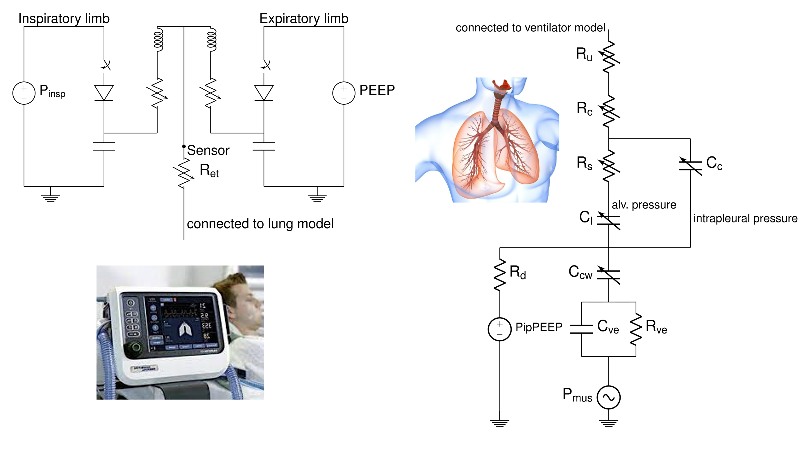
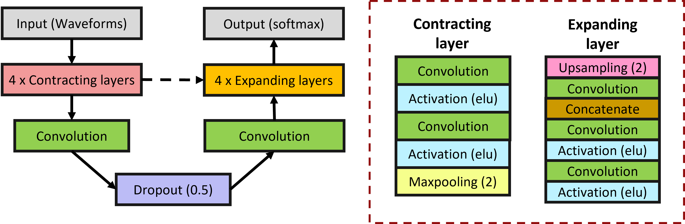
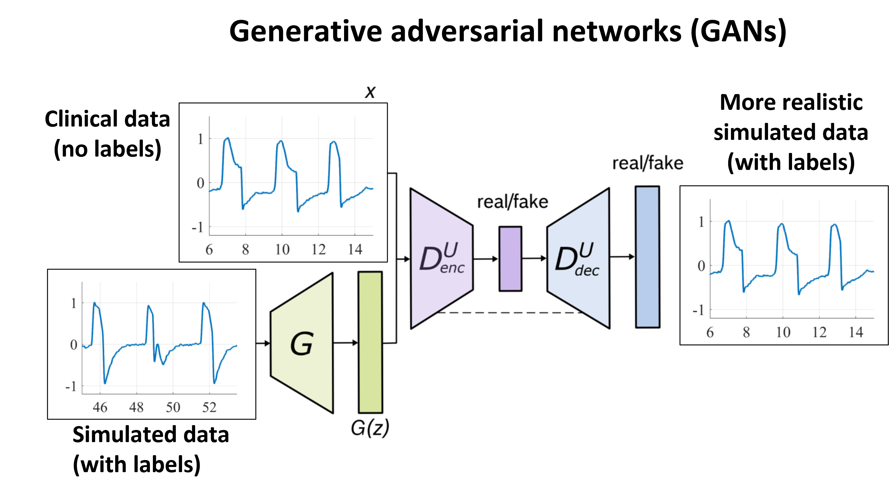

<a href="/research/02_perioperative/">Perioperative monitoring research</a>

Modelling the lung–ventilator interaction and analyzing ventilation waveforms to estimate respiratory effort and detect patient–ventilator asynchrony.

<nav aria-label="On this page" id="contents">
<strong>On this page</strong>
<ol class="research-line__contents-list">
<li><a href="#overview">Overview</a></li>
<li><a href="#modeling-of-the-lung-ventilator-system">Modeling of the lung-ventilator system</a></li>
<li><a href="#estimating-patient-respiratory-effort">Estimating patient respiratory effort</a></li>
<li><a href="#estimating-respiratory-system-parameters">Estimating respiratory system parameters</a></li>
<li><a href="#automatic-detection-of-patient-ventilator-asynchronies">Automatic detection of patient-ventilator asynchronies</a></li>
<li><a href="#combining-simulated-and-clinical-data">Combining simulated and clinical data</a></li>
<li><a href="#generating-realistic-annotated-waveforms-with-ventgan">Generating realistic annotated waveforms with VentGAN</a></li>
<li><a href="#multi-task-learning-with-limited-annotations">Multi-task learning with limited annotations</a></li>
<li><a href="#reducing-the-need-for-expert-annotations">Reducing the need for expert annotations</a></li>
<li><a href="#phd-theses">PhD theses</a></li>
<li><a href="#selected-publications-and-resources">Selected publications and resources</a></li>
<li><a href="#contributors-and-partners">Contributors and partners</a></li>
</ol></nav>

## Overview

Mechanical ventilation stands as a crucial medical intervention utilized to support individuals with compromised respiratory function. Employing a mechanical ventilator, this life-saving technique assists or replaces spontaneous breathing, particularly in intensive care units and emergency scenarios. Despite its indispensable role, mechanical ventilation is not without potential risks and complications. Patients undergoing this intervention may encounter challenges such as ventilator-associated lung injury, infections, hemodynamic instability, and notably, patient-ventilator asynchronies. These asynchronies refer to discrepancies in timing, flow, or volume between the patient's respiratory efforts and the ventilator's delivery of breath, posing an additional concern that healthcare professionals must carefully address to optimize patient outcomes.

## Modeling of the lung-ventilator system

Accurate modeling of the interaction between the lungs and the mechanical ventilator is of paramount importance for better understanding of the mechanical ventilation process and the more accurate estimation of important quantities such as the patient's work of breathing. Additionally, the occurrence of patient-ventilator asynchronies (PVAs), leading to patient discomfort, increased work of breathing and also linked to elevated mortality rates, underscores the need for real-time decision support to identify and manage these asynchronies.
Motivated by this, we proposed a method for creating a large, realistic, and labeled synthetic dataset. The aim is to facilitate the training and validation of machine learning algorithms capable of detecting a wide range of asynchrony types. The approach is based on a coupled  <a href="https://link.springer.com/article/10.1007/s10877-022-00822-4" target="_blank"> lung-ventilator model</a>: a non-linear lung-airway model is adapted for application in a diverse patient population; additionally, a first-order ventilator model is incorporated to generate labeled pressure, flow, and volume waveforms representative of pressure support ventilation. The model successfully reproduces fundamental measured lung mechanics parameters, and experienced clinicians were unable to differentiate between the simulated waveforms and actual clinical data. This rich annotated dataset is now publicly available at <a href="https://doi.org/10.4121/81220350-0f3d-4e0a-86cf-28c904a1cb09.v1" target="_blank">https://doi.org/10.4121/81220350-0f3d-4e0a-86cf-28c904a1cb09.v1</a>.

<figure style="max-width: 650px; margin-left: auto; margin-right: auto;">

<figcaption>Electrical equivalents of the ventilator (left) and lung models (right). Adapted from van Diepen et al. J Clin Monit Comput 36, 1739–1752 (2022). <a href="/images/lung_ventilator_model.png" target="_blank" rel="noopener">View full-size figure</a></figcaption>
</figure>

## Estimating patient respiratory effort

This model of the lungs and ventilator is also investigated for a better estimation of the patient’s respiratory effort. In fact, although various pressure-based techniques are available for estimating inspiratory effort at the bedside, uncertainty surrounds the accuracy of their estimations. This uncertainty arises because these techniques are largely based on a simplified linear model of the respiratory system, neglecting crucial factors such as the gas compressibility of air and the viscoelasticity and nonlinearities inherent in the respiratory system.
We thus performed an <a href="https://www.cell.com/heliyon/pdf/S2405-8440(23)00817-4.pdf" target="_blank"> in-silico study to compare pressure-based estimation techniques </a> and assess their accuracy using a more sophisticated model of the respiratory system and ventilator. The study evaluated the impact of several parameters on the accuracy of these techniques, including the patient's respiratory mechanics, positive end-expiratory pressure (PEEP), inspiratory pressure of the ventilator, gas compressibility of air, viscoelasticity of the respiratory system, and the strength of inspiratory effort.

**Main finding:** In the in-silico comparison, whole-breath occlusion had the lowest average and maximum errors across the patient archetypes evaluated.

On the other hand, techniques based on esophageal pressure demonstrated errors associated with the viscoelastic element in the model, resulting in higher errors compared to occlusion-based methods. The accuracy of esophageal pressure-based techniques was found to be highly dependent on the patient's pathology and ventilator settings, potentially evolving over time as the patient recovers or deteriorates.

## Estimating respiratory system parameters

In more recent work, we investigated an extended equation of motion for estimating respiratory system parameters during mandatory mechanical ventilation. Conventional approaches often assume constant airway resistance and neglect the viscoelastic behaviour of the respiratory system. The extended model accounts for both flow-dependent resistance and viscoelasticity, allowing these contributions to be estimated from the measured pressure and flow waveforms.

We compared the extended model with the conventional equation of motion and a model incorporating turbulent resistance, using simulations, test-lung experiments, and clinical measurements from ten patients.

**Main finding:** Across the simulated conditions, the extended model reduced the mean absolute percentage error in the estimated parameters to **3.5%**, compared with **11.5%** for the conventional model and **11.9%** for the turbulent-resistance model.

The test-lung experiments and small clinical study further explored the feasibility of estimating these parameters during mandatory ventilation. Together, these results show the importance of accounting for nonlinear resistance and viscoelasticity when interpreting respiratory mechanics.

[Read van Diepen et al., Biomedical Signal Processing and Control, 2026](https://doi.org/10.1016/j.bspc.2026.109770).

## Automatic detection of patient-ventilator asynchronies

The intricate interplay between patients and mechanical ventilators in clinical settings can sometimes lead to disruptions in the synchronization of their respiratory efforts, giving rise to a phenomenon known as patient-ventilator asynchronies (PVAs). This refers to the mismatches in timing, flow, or volume coordination between a patient's spontaneous breathing efforts and the assistance provided by the mechanical ventilator. Patient-ventilator asynchronies have attracted increasing attention within the realm of critical care, as their occurrence can have significant implications for patient outcomes. These asynchronies can compromise the effectiveness of ventilation, contribute to patient discomfort, and, in severe cases, may lead to respiratory muscle fatigue or injury. They have also been associated with increased length of ICU stay and mortality. In present clinical practice, PVAs are typically identified and explored through the visual assessment conducted by intensive care physicians. Nevertheless, this method has notable limitations. Firstly, visual inspection is time-consuming and susceptible to subjective interpretation. Secondly, maintaining continuous monitoring through visual means is impractical, potentially leading to the oversight of a significant number of PVAs. Third, accurate detection and classification of PVAs by visual analysis requires trained clinical staff.
Here we proposed a <a href="https://ieeexplore.ieee.org/stamp/stamp.jsp?tp=&arnumber=9175796" target="_blank"> machine learning approach for automatic detection and classification of PVAs </a>. The proposed method is based on a U-net architecture, appropriately adjusted for 1-D signals (measured pressure, flow and volume). Based on these input signals, the network learned to recognize the start and end of patient's respiratory efforts. Comparing these timings with ventilator triggering and cycling enables the detection and classification of different PVAs.

**Main finding:** In the original evaluation, patient-effort detection achieved sensitivity and precision of **98.6% and 97.3% for inspiratory efforts**, and **97.7% and 97.2% for expiratory efforts**. Classification accuracy ranged from **90% to 98%** across the PVA types evaluated.

<figure style="max-width: 650px; margin-left: auto; margin-right: auto;">

<figcaption>Adapted U-net architecture for automatic detection of PVAs. <a href="/images/unet_tom.png" target="_blank" rel="noopener">View full-size figure</a></figcaption>
</figure>

## Combining simulated and clinical data

To improve the model, we extended the training by using simulated data produced with the model of the lung-ventilator system explained above. We found that the <a href="https://www.sciencedirect.com/science/article/pii/S0169260722007143" target="_blank"> combination of simulated and clinical data </a> for training the algorithm achieved the best performance.

## Generating realistic annotated waveforms with VentGAN

A further improvement in detection and classification performance was obtained by refining the simulation through a <a href="https://www.sciencedirect.com/science/article/pii/S0169260724001718?via%3Dihub" target="_blank"> generative-adversarial network (GAN) approach (VentGAN)</a>. Although clinical data with good-quality labels is scarce, large ventilation datasets are available without labels. The idea is to learn the characteristics of clinical data which cannot be modeled by the simulator through adversarial learning. By using the simulated data as input, however, we are able to maintain the known timings, and thus generate a more realistic simulated dataset with labels. The idea is summarized schematically by the figure below. We evaluated the approach by training an asynchrony-detection model on the generated waveforms and testing it on independent, expert-labelled clinical data.

**Main finding:** Training with VentGAN-generated waveforms significantly improved classification of **late cycling, early cycling, and normal breaths**. Delayed inspiration showed no significant improvement, while performance for ineffective efforts decreased, indicating that the benefit depends on the type of asynchrony.

<figure style="max-width: 650px; margin-left: auto; margin-right: auto;">

<figcaption>GAN framework for generating a large dataset of realistic ventilation data with labels. <a href="/images/gan_pva.png" target="_blank" rel="noopener">View full-size figure</a></figcaption>
</figure>

## Multi-task learning with limited annotations

In his master's work, Amin Sabbah investigated a multi-task learning approach for detecting patient-ventilator asynchrony. A shared network learns to identify the timing of patient respiratory efforts together with an auxiliary task: identifying the start and end of ventilator cycles. This additional task provides temporal information that can be learned from clinical waveforms without expert PVA annotations.

The model was trained using labelled simulations together with clinical data from Catharina Hospital for the auxiliary task, and evaluated on an independent, expert-labelled dataset from San Matteo Hospital.

**Main finding:** Multi-task learning achieved an average **F1 score of 88.3%** across the four asynchrony types evaluated, compared with **82.4%** for the simulation-trained U-net and **83.0%** for VentGAN-based training in the same comparison.

[Read Sabbah et al., EUSIPCO, 2026](https://eurasip.org/Proceedings/Eusipco/Eusipco2026/pdfs/0001726.pdf) · [Explore the code](https://github.com/tue-bmd/pva-multitask).

## Reducing the need for expert annotations

Training asynchrony-detection models requires expert-labelled ventilation waveforms, which are time-consuming to obtain. In a semi-supervised approach, we use distance-based clustering to select waveforms for annotation and project the resulting labels onto similar data.

**Main finding:** On the evaluated San Matteo dataset, distance-based clustering reduced expert annotation effort by **more than 75%**, with classification performance close to training with fully labelled data.

Application to a separate Maasstad Hospital dataset also highlighted the importance of annotation consistency. [Read van de Kamp et al., IEEE Open Journal of Control Systems, 2026](https://doi.org/10.1109/OJCSYS.2026.3685094).

## PhD theses

- **Anouk Waeijen-van Diepen (2025):** [Modeling & analysis of patient-ventilator interactions](https://pure.tue.nl/ws/portalfiles/portal/353695427/20250403_Waeijen_van_Diepen_hf.pdf).
- **Tom Bakkes (2025):** [Machine learning for clinical decision support in perioperative and intensive care](https://pure.tue.nl/ws/portalfiles/portal/353886332/20250403_Bakkes_hf.pdf).

## Selected publications and resources

1. van Diepen A, Bakkes THGF, De Bie AJR, Turco S, Bouwman RA, Woerlee PH, Mischi M. **A model-based approach to generating annotated pressure support waveforms.** Journal of Clinical Monitoring and Computing, 2022. [Read the paper](https://doi.org/10.1007/s10877-022-00822-4).
2. van Diepen A, Bakkes THGF, De Bie AJR, Turco S, Bouwman RA, Woerlee PH, Mischi M. **Evaluation of the accuracy of established patient inspiratory effort estimation methods during mechanical support ventilation.** Heliyon, 2023. [Read the paper](https://doi.org/10.1016/j.heliyon.2023.e13610).
3. van Diepen A, Bakkes THGF, De Bie AJR, …, Turco S. **Estimation of respiratory system parameters using an extended equation of motion during mandatory mechanical ventilation.** Biomedical Signal Processing and Control, 2026. [Read the paper](https://doi.org/10.1016/j.bspc.2026.109770).
4. Bakkes THGF, Montree RJH, Mischi M, Mojoli F, Turco S. **A machine learning method for automatic detection and classification of patient-ventilator asynchrony.** IEEE EMBC, 2020. [Read the paper](https://doi.org/10.1109/EMBC44109.2020.9175796).
5. Bakkes T, van Diepen A, De Bie A, …, Turco S. **Automated detection and classification of patient-ventilator asynchrony by means of machine learning and simulated data.** Computer Methods and Programs in Biomedicine, 2023. [Read the paper](https://doi.org/10.1016/j.cmpb.2022.107333).
6. Hao L, Bakkes THGF, van Diepen A, …, Turco S. **An adversarial learning approach to generate pressure support ventilation waveforms for asynchrony detection.** Computer Methods and Programs in Biomedicine, 2024. [Read the paper](https://doi.org/10.1016/j.cmpb.2024.108175).
7. van de Kamp L, Weller D, Thijssen R, Hunnekens B, Bakkes T, Turco S, den Uil C, Oomen T, van de Wouw N. **Reducing annotation effort in patient-ventilator asynchrony detection with distance-based clustering.** IEEE Open Journal of Control Systems, 2026. [Read the paper](https://doi.org/10.1109/OJCSYS.2026.3685094).
8. Sabbah A, Bakkes THGF, De Bie A, Mischi M, Turco S. **Multi-task learning for the detection of patient-ventilator asynchrony.** EUSIPCO, 2026. [Read the paper](https://eurasip.org/Proceedings/Eusipco/Eusipco2026/pdfs/0001726.pdf).

### Code and data

- **Multi-task learning for PVA detection:** [Code accompanying Amin Sabbah's work](https://github.com/tue-bmd/pva-multitask).
- **Simulated pressure-support ventilation waveforms:** [Annotated dataset from Anouk Waeijen-van Diepen's lung–ventilator model](https://doi.org/10.4121/81220350-0f3d-4e0a-86cf-28c904a1cb09.v1).

## Contributors and partners

### Research team

* Anouk Waeijen-van Diepen (former PhD student)
* Tom Bakkes (former PhD student, now postdoctoral researcher)
* Liming Hao (former visiting PhD student)
* Amin Sabbah (former master student)
* Nishith Chennakeshava (PhD student)
* Pierre Woerlee (part-time professor)
* Massimo Mischi (full professor, head of BM/d)

### Collaborators and partners

* Catharina Ziekenhuis Eindhoven
* Policlinico S. Matteo (Pavia, Italy)

### Funding

* Eindhoven MedTech Innovation Center (e/MTIC)
* TKI-HTSM MEDICAID - Top Sector Holland High Tech
*  China Scholarship Council (CSC), National Key Research and Development Project of China
* Academic Excellence Foundation of BUAA for PhD Students

<figure style="max-width: 700px; margin-left: auto; margin-right: auto;">

</figure>

<a href="#contents">Back to contents</a> · <a href="/research/02_perioperative/">Perioperative monitoring research</a> · <a href="/publications/">Publications and code</a>

