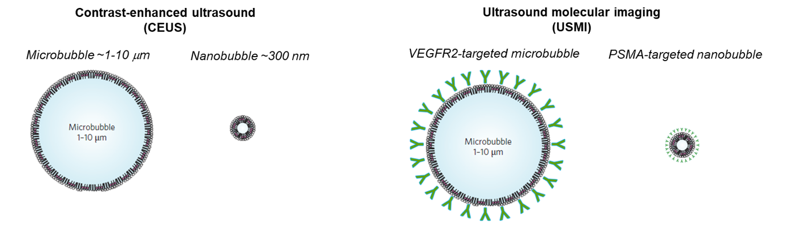
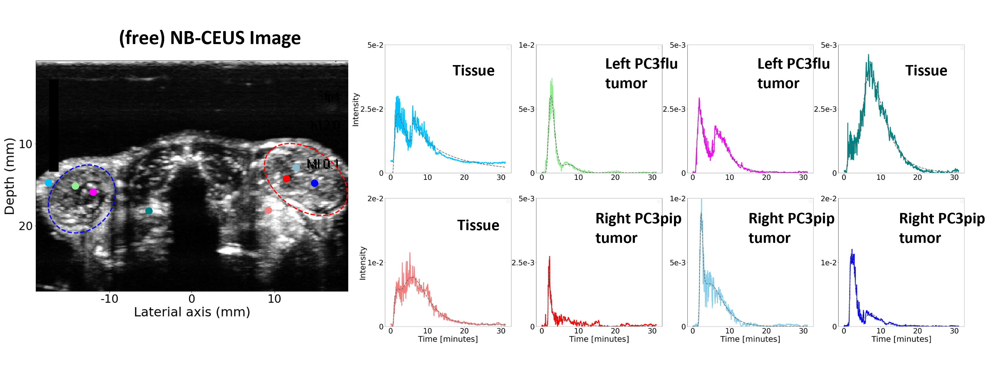
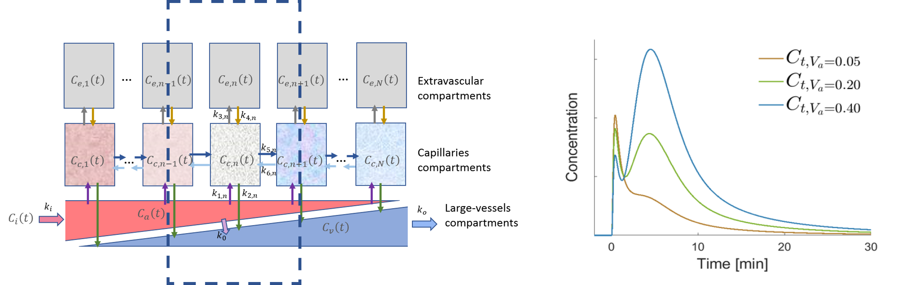
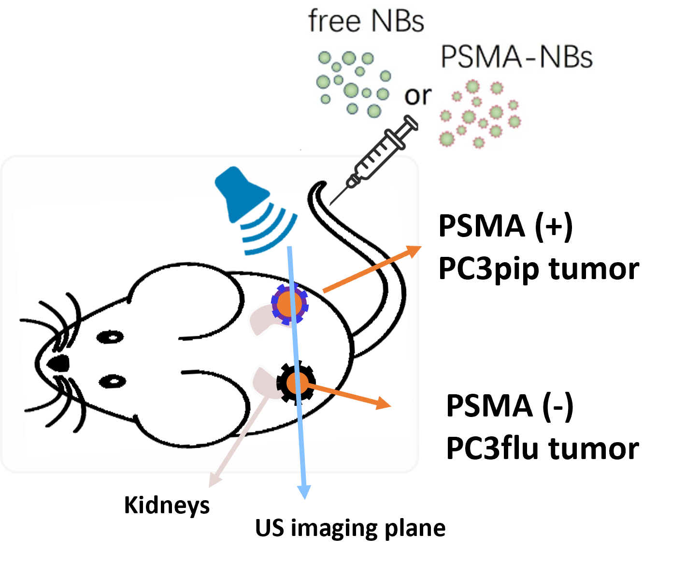
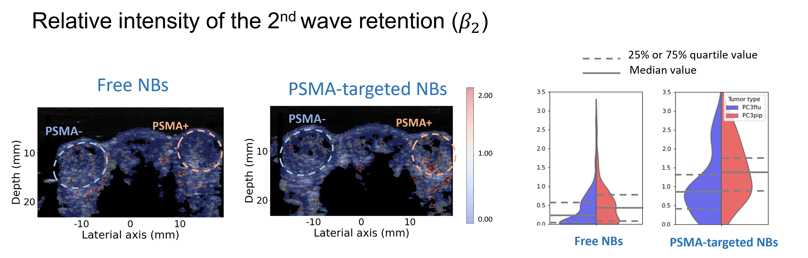
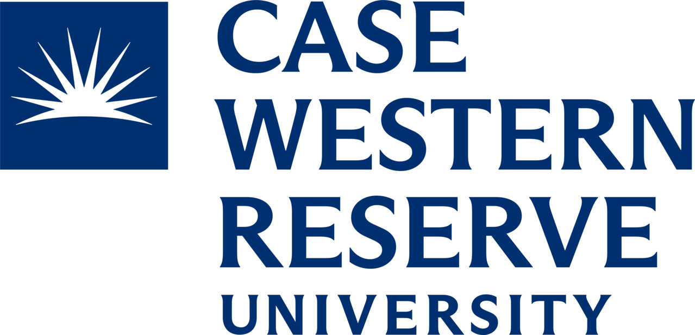

<a href="/research/01_cancer/">Cancer imaging research</a>

Pharmacokinetic models of nanobubble transport, tissue distribution, and molecular binding for quantitative ultrasound cancer imaging.

<nav aria-label="On this page" id="contents">
<strong>On this page</strong>
<ol class="research-line__contents-list">
<li><a href="#overview">Overview</a></li>
<li><a href="#the-second-wave-phenomenon">The second-wave phenomenon</a></li>
<li><a href="#pharmacokinetic-modelling">Pharmacokinetic modelling</a></li>
<li><a href="#psma-targeted-nanobubbles">PSMA-targeted nanobubbles</a></li>
<li><a href="#momentum">MOMENTUM</a></li>
<li><a href="#selected-publications-and-resources">Selected publications and resources</a></li>
<li><a href="#contributors-and-partners">Contributors and partners</a></li>
</ol></nav>

## Overview

Nanobubbles are experimental ultrasound contrast agents. These miniature gas-filled structures, typically about ten times smaller than microbubbles, can pass through the capillary network and may extravasate in case of enhanced permeability such as in cancer and inflammation. When their shell is decorated with suitable ligands, they can then reach targets that go beyond the vessel wall. Because of their more complex kinetics and distribution in and out of the vasculature, dedicated models and quantification strategies are needed - this is the focus of this line of research.

<figure style="max-width: 650px; margin-left: auto; margin-right: auto;">

<figcaption>Nanobubble contrast agents have been developed for contrast-enhanced ultrasound and ultrasound molecular imaging. <a href="/images/ceus_vs_nb.png" target="_blank" rel="noopener">View full-size figure</a></figcaption>
</figure>

## The second-wave phenomenon

The investigation into nanobubble (NB) pharmacokinetics in contrast-enhanced ultrasound (CEUS) at the pixel level has unveiled a distinctive phenomenon by which the initial passage of the contrast agent bolus is accompanied by a second wave. Notably, this effect has not been previously observed in CEUS utilizing microbubbles. This motivated us to explore and understand this <a href="https://www.nature.com/articles/s41598-022-17756-1" target="_blank"> second-wave phenomenon</a> and its potential clinical applications. We characterized this phenomenon by a dedicated pharmacokinetic model and used this model to fit time-intensity curves (TICs) extracted from NB-CEUS. The resulting model parameters were presented as parametric maps to visually depict the characteristics of tumor lesions. Two model parameters, namely the ratio of peak intensities of the second wave over the first and the decay rate of the wash-out process, exhibited significant differences between malignant tumors and normal tissue, suggesting that this unique phenomenon has the potential to support the diagnosis of cancerous lesions.

<figure style="max-width: 650px; margin-left: auto; margin-right: auto;">

<figcaption>Examples of time-intensity curves (TICs) exhibiting the second wave phenomenon. Adapted from Chen et al. Scientific Reports 2022. <a href="/images/second_wave.png" target="_blank" rel="noopener">View full-size figure</a></figcaption>
</figure>

## Pharmacokinetic modelling

Motivated by the promising findings, we developed <a href="https://ieeexplore.ieee.org/abstract/document/9799708" target="_blank">compartmental pharmacokinetic models</a> designed to elucidate the second-wave phenomenon. Using these models, a more detailed analysis becomes possible, allowing for an in-depth examination of the influence of various physiological factors on the attributes of the second-wave phenomenon. We found that a double modified local density random walk (mLDRW) model, despite its simplicity and reliance on robust assumptions, enabled fitting of the experimental data, facilitating the estimation of multiple parametric maps for the quantitative and visual representation of in-vivo pharmacokinetics of NBs. Our findings confirm that the second-wave phenomenon is influenced by various physiological factors, highlighting the model's potential for application in pertinent clinical scenarios.

<figure style="max-width: 650px; margin-left: auto; margin-right: auto;">

<figcaption>Schematic diagram of 3-layer compartmental pharmacokinetic model, together with example TICs obtained from the highlighted section. Adapted from Chen et al. IEEE BME 2022. <a href="/images/pk_secondwave.png" target="_blank" rel="noopener">View full-size figure</a></figcaption>
</figure>

## PSMA-targeted nanobubbles

Besides being able to cross the vessel wall, nanobubbles can also be decorated with ligands on their shell to target specific molecules. One relevant target for prostate cancer is the prostate-specific membrane antigen (PSMA), over-expressed on prostate-cancer cells. It has been established that PSMA-targeted NBs can effectively attach to the receptors of prostate cancer cells, exhibiting an extended retention effect in dual-tumor mouse models.

<figure style="width: 60%; max-width: 390px; margin-left: auto; margin-right: auto;">

<figcaption>Schematic diagram explaining the dual-tumor mouse model. <a href="/images/mouse_model.png" target="_blank" rel="noopener">View full-size figure</a></figcaption>
</figure>

Nevertheless, the assessment of this prolonged retention effect has been constrained to qualitative or semi-quantitative methods thus far.
To describe the kinetics of targeted nanobubbles we proposed two pharmacokinetic models, one based on a vascular input given by a mLDRW model, while the other takes inspiration from the reference tissue model, previously developed for nuclear imaging. Our results show that several parameters from these two models are able to distinguish between the kinetics of targeted and free nanobubbles.

Motivated by this, we further set out to investigate whether the estimated parameters were different between PSMA-expressing and non-PSMA-expressing tumors in dual-tumor mouse models of prostate cancer. The dual tumor model is ideal to test our hypothesis because it features one tumor expressing PSMA (PSMA+) on one flank of each mouse, and one tumor not expressing PSMA (PSMA-) on the other flank of the mouse. We found that, compared with the TICs of free NBs, TICs of PSMA-NBs present higher peak intensity and a more delayed second wave, especially in the PSMA+ tumor.

**Main finding:** The peak time and residual factor of the second wave were significantly different between **PSMA-positive and PSMA-negative tumors** when using PSMA-targeted nanobubbles in the dual-tumor mouse model.

<figure style="max-width: 650px; margin-left: auto; margin-right: auto;">

<figcaption>Parametric maps and violin plots of the 2nd wave retention parameter, highlighting differences between PSMA-targeted and free NBs in PSMA+ and PSMA- tumors. Adapted from Chen et al. MIB 2023. <a href="/images/psma_comparison.png" target="_blank" rel="noopener">View full-size figure</a></figcaption>
</figure>

## MOMENTUM

**Funding:** NWO Open Technology Programme

**My role:** Main applicant and project leader

MOMENTUM builds on this work to investigate nanobubble-enhanced ultrasound for cancer diagnostics. The project connects vascular models, the physical and acoustic characterization of nanobubbles, and quantitative analysis of their transport and distribution in tissue.

[Project announcement](/posts/2025/10/15/otp_momentum/) · [Cancer imaging research](/research/01_cancer/)

## Selected publications and resources

1. Chen C, Perera R, Kolios MC, Wijkstra H, Exner AA, Mischi M, Turco S. **The unique second wave phenomenon in contrast enhanced ultrasound imaging with nanobubbles.** Scientific Reports, 2022. [Read the paper](https://doi.org/10.1038/s41598-022-17756-1).
2. Chen C, Perera R, Kolios MC, Wijkstra H, Exner AA, Mischi M, Turco S. **Pharmacokinetic modeling of the second-wave phenomenon in nanobubble-based contrast-enhanced ultrasound.** IEEE Transactions on Biomedical Engineering, 2023. [Read the paper](https://doi.org/10.1109/TBME.2022.3184266).
3. Chen C, Perera R, Kolios MC, Wijkstra H, Mischi M, Exner AA, Turco S. **Pharmacokinetic modeling of PSMA-targeted nanobubbles for quantification of extravasation and binding in mice models of prostate cancer.** Medical Physics, 2022. [Read the paper](https://doi.org/10.1002/mp.15962).
4. Chen C, Perera R, Mischi M, Kolios M, Exner A, Turco S. **Quantification of extravasation and binding of PSMA-targeted nanobubbles by modelling the second-wave phenomenon.** Molecular Imaging and Biology, 2023. [Read the paper](https://doi.org/10.1007/s11307-023-01891-w).

## Contributors and partners

### Research team

* Chuan Chen (former Postdoc researcher)
* Massimo Mischi (full professor, head of BM/d)

### Collaborators and partners

* Exner lab, Case Western Reserve University
* Kolios lab, Toronto Metropolitan University

### Funding

* 4TU High Tech for a sustainable future, Precision Medicine program
* NWO Open Technology Programme — MOMENTUM

  <figure class="research-line__partner-logo">

</figure>
  <figure class="research-line__partner-logo">

</figure>
  <figure class="research-line__partner-logo">

</figure>
  <figure class="research-line__partner-logo">

</figure>

<a href="#contents">Back to contents</a> · <a href="/research/01_cancer/">Cancer imaging research</a> · <a href="/publications/">Publications and code</a>

