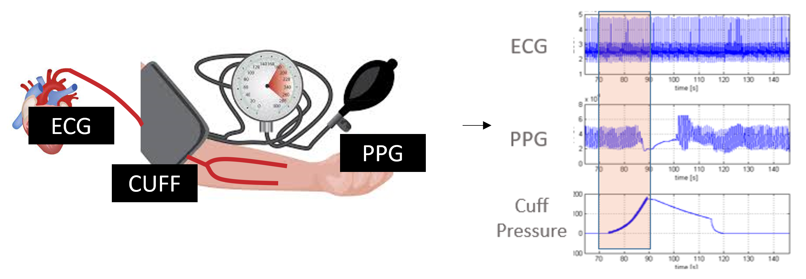
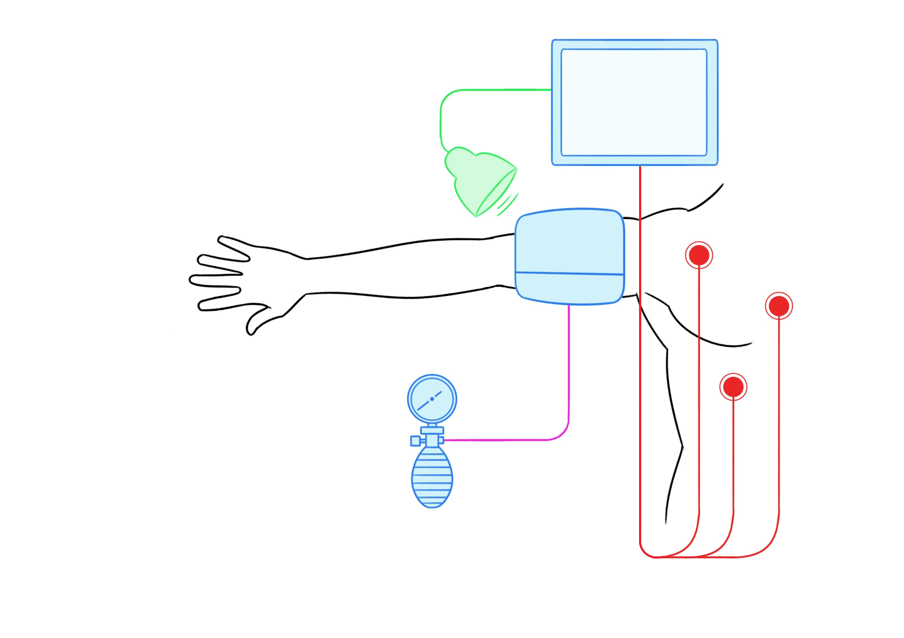
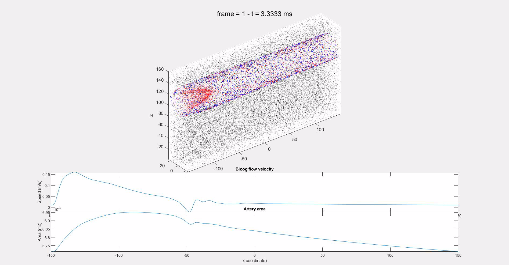

<a href="/research/02_perioperative/">Perioperative monitoring research</a>

Physiological models and non-invasive measurements to improve the assessment of cardiovascular function, from blood pressure cuffs to ultrafast ultrasound.

<nav aria-label="On this page" id="contents">
<strong>On this page</strong>
<ol class="research-line__contents-list">
<li><a href="#overview">Overview</a></li>
<li><a href="#cuff-based-hemodynamic-assessment">Cuff-based hemodynamic assessment</a></li>
<li><a href="#local-pulse-wave-velocity-by-ultrasound">Local pulse wave velocity by ultrasound</a></li>
<li><a href="#temporal-sampling-and-frame-rate-enhancement">Temporal sampling and frame-rate enhancement</a></li>
<li><a href="#phd-thesis">PhD thesis</a></li>
<li><a href="#selected-publications-and-resources">Selected publications and resources</a></li>
<li><a href="#contributors-and-partners">Contributors and partners</a></li>
</ol></nav>

## Overview

Hemodynamic monitoring involves the continuous assessment of cardiovascular function to understand how the heart and blood vessels are functioning. Despite the range of measurements available at the bedside, challenges remain in interpreting standard variables, obtaining a complete picture of cardiovascular function, and detecting deterioration early.

In this line of research, we propose theoretical frameworks and experimental methods to extract more information from standard clinical equipment. Our work connects cuff-based blood pressure measurements, physiological modelling, and ultrasound measurements of local arterial function.

## Cuff-based hemodynamic assessment

A blood pressure cuff is both a measurement device and a mechanical load on the limb. Understanding how the cuff, tissue, and vessels interact can help explain the information contained in oscillometric signals and the limitations of standard blood pressure estimates.

Our earlier work investigated the cuff as a transducer, modelled arterial compliance, and studied how cuff inflation affects pulse propagation and blood flow. These methods aim to improve the interpretation of measurements while retaining the advantages of non-invasive equipment.

<figure style="max-width: 650px; margin-left: auto; margin-right: auto;">

<figcaption>Schematic drawing of standard hospital equipment for hemodynamic monitoring. <a href="/images/hemo_intro.png" target="_blank" rel="noopener">View full-size figure</a></figcaption>
</figure>

Agata Barbagini’s work extends this research by combining ultrasound and cuff-based measurements. In an exploratory study in two ICU patients and one healthy volunteer, we measured the brachial artery upstream and downstream of a cuff during stepwise deflation. The measurements allowed us to examine changes in arterial area, blood flow, and pulse arrival time as the external pressure changed. The responses varied between subjects, motivating further investigation of the interaction between cuff pressure and local arterial function.

<figure style="max-width: 480px; margin-left: auto; margin-right: auto;">

<figcaption>Setup for ultrasound-based exploration of vascular responses to cuff pressure, with ECG recorded alongside the ultrasound and cuff signals. From Agata Barbagini’s ESICM poster. <a href="/images/hemodynamics/agata-cuff-ultrasound-setup.jpg" target="_blank" rel="noopener">View full-size figure</a></figcaption>
</figure>

## Local pulse wave velocity by ultrasound

Pulse wave velocity describes how fast a pressure wave travels along an artery and provides information about arterial stiffness. Agata Barbagini’s work investigates whether ultrafast ultrasound can measure local pulse wave velocity in the brachial artery without a separate continuous pressure measurement.

We compared approaches based on wall displacement, tissue Doppler imaging, and a two-dimensional Fourier transform. Controlled simulations were complemented by a proof-of-concept experiment in four healthy volunteers.

**Main finding:** The two-dimensional Fourier approach provided the most accurate and noise-robust estimates in the simulated physiological range of **5–10 m/s**. The volunteer measurements supported feasibility, but the small pilot does not establish clinical accuracy.

[Read Barbagini et al., IEEE Transactions on Instrumentation and Measurement, 2026](https://doi.org/10.1109/TIM.2026.3712979).

<figure style="max-width: 650px; margin-left: auto; margin-right: auto;">

<figcaption>Example of the brachial artery simulation used to investigate ultrasound-based pulse wave velocity estimation. The model represents scatterers in blood, the arterial wall, and surrounding tissue, together with prescribed flow and arterial area waveforms. From Agata Barbagini’s MeMeA 2025 presentation. <a href="/images/hemodynamics/agata-brachial-artery-simulation.png" target="_blank" rel="noopener">View full-size figure</a></figcaption>
</figure>

## Temporal sampling and frame-rate enhancement

Estimating pulse wave velocity in a small peripheral artery requires both high spatial and temporal resolution. We investigated alternative processing strategies that increase effective temporal sampling without increasing the ultrasound transmission pulse repetition frequency.

The study compared conventional compound-first processing, per-angle motion-first estimation, and time-aligned motion-first estimation using numerical simulations of the brachial artery. Time alignment partially mitigated undersampling, but increased sensitivity to noise. This work identifies sampling and noise robustness as priorities for further development.

[Read Barbagini et al., IEEE MeMeA, 2026](https://doi.org/10.1109/MEMEA69746.2026.11537364).

## PhD thesis

The earlier work is described in [Laura Bogatu’s PhD thesis on hemodynamic monitoring (2022)](https://pure.tue.nl/ws/portalfiles/portal/203595959/20220609_Bogatu_hf.pdf).

## Selected publications and resources

1. Bogatu L, Turco S, Mischi M, Woerlee P, Bouwman A, Korsten E. **A modelling framework for assessment of arterial compliance by fusion of oscillometry and pulse wave velocity information.** Computer Methods and Programs in Biomedicine, 2020. [Read the paper](https://doi.org/10.1016/j.cmpb.2020.105492).
2. Bogatu LI, Turco S, Mischi M, et al. **Modulation of pulse propagation and blood flow via cuff inflation—new distal insights.** Sensors, 2021. [Read the paper](https://doi.org/10.3390/s21165593).
3. Bogatu L, Turco S, Mischi M, et al. **Air cuff transducer design for occlusion-based hemodynamic measurements—an experimental and simulation study.** IEEE Transactions on Instrumentation and Measurement, 2022. [Read the paper](https://doi.org/10.1109/TIM.2022.3193980).
4. Suriani I, Barbagini A, de Boer EC, Turco S, et al. **Single-measurement local pulse wave velocity estimation in the carotid artery using pulsed wave Doppler ultrasound waveform indices.** IEEE Transactions on Instrumentation and Measurement, 2025. [Read the paper](https://doi.org/10.1109/TIM.2025.3571080).
5. Barbagini A, Turco S, Shevchenko R, Muehlsteff J, Mischi M. **Local brachial pulse wave velocity estimation via ultrafast ultrasound: comparison between three different approaches.** IEEE Transactions on Instrumentation and Measurement, 2026. [Read the paper](https://doi.org/10.1109/TIM.2026.3712979).
6. Barbagini A, Turco S, Muehlsteff J, Mischi M. **Comparison of frame-rate enhancement strategies for brachial pulse wave velocity estimation by ultrafast ultrasound.** IEEE MeMeA, 2026. [Read the paper](https://doi.org/10.1109/MEMEA69746.2026.11537364).

## Contributors and partners

### Research team

* Laura Bogatu (former PhD student)
* Agata Barbagini (PhD student)
* Pierre Woerlee (part-time professor)
* Massimo Mischi (professor)

### Collaborators and partners

* Philips Research
* Catharina Ziekenhuis Eindhoven

### Funding

* Eindhoven MedTech Innovation center (e/MTIC)
* Impuls 2 Health - Philips
* TKI-HTSM PISANO - Top Sector Holland High Tech

<figure style="max-width: 700px; margin-left: auto; margin-right: auto;">

</figure>

<a href="#contents">Back to contents</a> · <a href="/research/02_perioperative/">Perioperative monitoring research</a> · <a href="/publications/">Publications and code</a>

